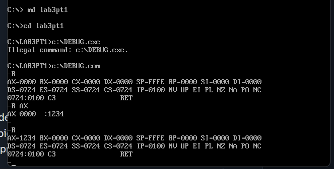
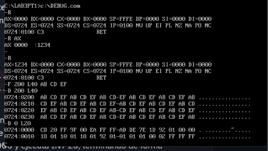
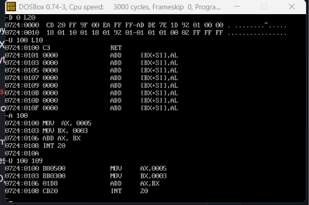
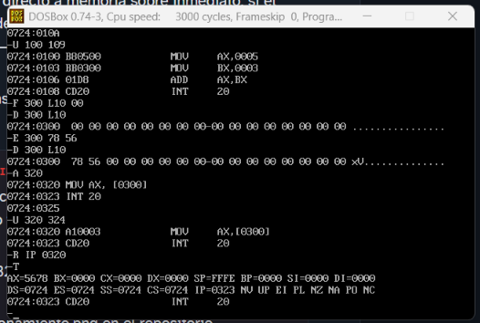

## Postcontenido 1 Unidad 3

### Checkpoint 1: Estado inicial de los registros

Al ejecutar el comando `R` sin argumentos, se observó que los registros de propósito general (AX, BX, CX y DX) valen 0000 y que SP vale FFFE, el tope inicial de la pila. Los cuatro registros de segmento (DS, ES, SS y CS) tienen el mismo valor, porque DOS asigna el segmento del PSP al programa. El IP vale 0100, la primera dirección ejecutable después del PSP. Esta captura corresponde a la sesión en `C:\LAB3PT1>`.

### Checkpoint 2: Volcado hexadecimal

Se rellenaron 64 bytes desde DS:0200 con el patrón AB CD EF usando `F 200 L40 AB CD EF` y se volcaron con `D 200 L40`. La salida del comando `D` tiene tres columnas. La primera muestra la dirección en formato segmento:desplazamiento. La segunda muestra 16 bytes por fila en hexadecimal, separados en dos grupos de 8 por un guion. La tercera muestra la representación ASCII de esos bytes. En esta captura la columna ASCII solo muestra puntos, porque AB, CD y EF no son caracteres imprimibles (el rango imprimible es 0x20 a 0x7E). El patrón se repite cíclicamente en las cuatro filas.

### Checkpoint 3: Ensamblado y desensamblado

Con el comando `A 100` se ingresó un programa de cuatro instrucciones y con `U 100 109` se verificó su codificación. Se observó que `MOV AX,0005` se codifica como `B8 05 00`, `MOV BX,0003` como `BB 03 00`, `ADD AX,BX` como `03 C3` e `INT 20` como `CD 20`. El programa ocupa 10 bytes. En los valores inmediatos de 16 bits se aprecia el formato little-endian: el byte menos significativo se almacena primero.

### Checkpoint 4: Memoria y direccionamiento directo

Se limpió una región de 16 bytes en DS:0300 con `F 300 L10 00`, y luego `E 300 78 56` modificó únicamente los dos primeros bytes, lo que se confirmó con dos volcados `D 300 L10`. Después se ensambló `MOV AX,[0300]` en CS:0320, que `U` mostró codificada como `A1 00 03`. Al ejecutarla con `T` (con IP en 0320), AX pasó a valer 5678, lo cual confirma que los bytes 78 56 se leyeron como la palabra little-endian 0x5678.

### Decisión técnica 1: Verificación no destructiva de una escritura (Paso 12)

Para confirmar que la escritura del Paso 11 tuvo el efecto esperado, se selecciona el comando D, porque es el único de los cuatro que solo lee memoria y no altera el estado del programa. El comando E con la lista completa de bytes (E 300 78 56) es determinista: escribe exactamente esos dos bytes y termina. En cambio, E 300 sin lista entra en modo interactivo, muestra el valor actual de cada byte y espera una tecla; si se escribe un valor por error, ese byte queda sobrescrito, de modo que la verificación podría modificar justamente lo que debía comprobar. El comando F tampoco es adecuado: aunque opera sobre un rango como D, escribe su patrón sobre todo el rango indicado y destruiría los bytes 78 56 que se querían verificar. El comando R muestra registros, no memoria, y con un nombre de registro (R AX) permite modificarlos. Por eso D 300 L10 es la opción segura: muestra los 16 bytes en hexadecimal y ASCII sin escribir nada y puede repetirse las veces que sea necesario.

### Decisión técnica 2: Direccionamiento inmediato frente a directo (Paso 14)

Aunque MOV AX,0005 (B8 05 00) y MOV AX,[0300] (A1 00 03) ocupan 3 bytes cada una, el direccionamiento directo a memoria requiere un acceso adicional al bus de memoria durante la ejecución. En el modo inmediato, el valor 0x0005 viaja dentro del propio flujo de instrucciones, así que queda disponible en el mismo fetch que trae la instrucción. En el modo directo, la instrucción solo contiene la dirección 0x0300: el procesador debe formar la dirección DS:0300 y realizar una lectura extra para obtener el dato. El estudiante preferiría el direccionamiento directo cuando el valor puede cambiar en tiempo de ejecución, como el 0x5678 escrito previamente con E en DS:0300, porque la instrucción lee el contenido actual de esa posición sin necesidad de reensamblar el programa; el modo inmediato solo sirve para constantes conocidas al ensamblar. Con el comando U, sin ejecutar ninguna instrucción, se distingue la codificación: B8 con el valor sin corchetes indica inmediato, y A1 con la dirección entre corchetes indica directo a memoria.
